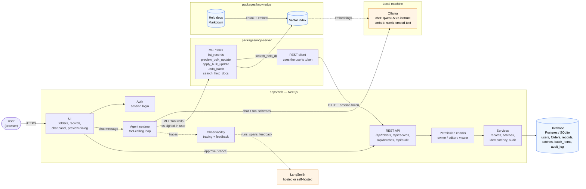
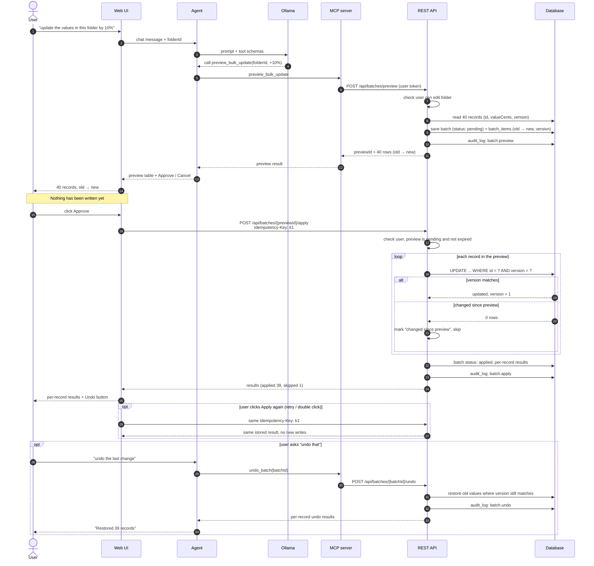
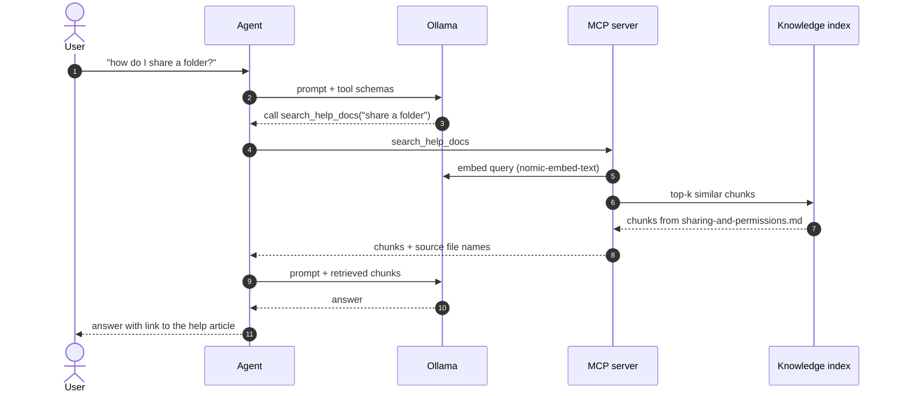
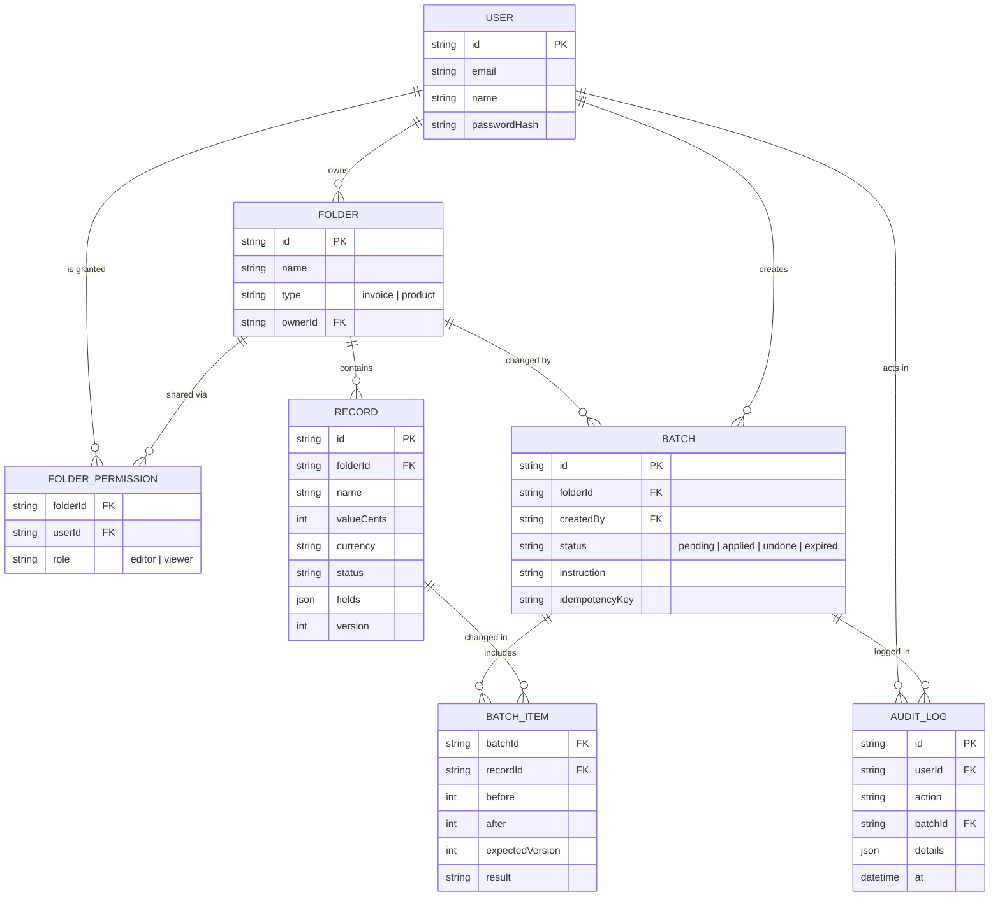

# Ledgerly — Architecture

Diagrams are written in Mermaid. They render on GitHub, GitLab, and in VS Code with a Mermaid preview extension.

## 1. System overview

**Trust boundaries**
- The agent has **no database access**. Its only path to data is the MCP tools, which call the REST API with the signed-in user's token. Permissions are checked in the API, the same as for the UI.
- **Approval comes from the UI, not the agent.** The user's click on **Approve** sends the preview ID to the API. The agent can propose a change, but the API rejects any apply without a matching approved preview.
- **Ollama** runs locally. **LangSmith** is the only component that sends data off the machine, and tracing can be turned off.

## 2. Bulk update: preview → approve → apply → undo

## 3. How-to question (RAG)

## 4. Data model

